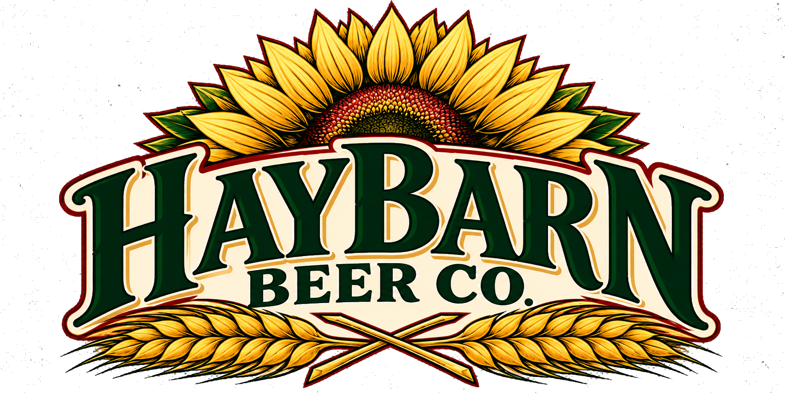

# Haybarn Beer Co. — starter website

A responsive, rustic four-page website built with plain HTML, external CSS, and external JavaScript.

## Pages
- `index.html` — home / brand introduction
- `story.html` — brand story
- `beer.html` — beer lineup placeholders and tasting feedback
- `visit.html` — social placeholders and opening-announcement signup

## Preview locally
Open `index.html` in a browser, or run a local static server from this folder:
```bash
python -m http.server 8000
```
Then visit `http://localhost:8000`.

## Before publishing
This is a designed starter, not a fully connected production site. The forms deliberately show a message that submissions are not being saved until the relevant services are configured.

### 1. Add the actual logo
The supplied logo has been added at `assets/haybarn-logo.png` and is used in the header on all four pages. The original upload had a checkerboard baked into the image, so a first-pass background removal was applied. Inspect the result at different backgrounds before launch; if any gray remnants remain, request a transparent PNG or SVG from the owner. The header uses markup like:
```html

```
Add suitable `.brand-logo` sizing to `style.css`. Keep a high-resolution transparent PNG or SVG if the owner can provide one.

### 2. Save tasting feedback with Supabase
1. Create a Supabase project.
2. Open its SQL Editor and run `supabase-setup.sql`.
3. Copy the project URL and the public anon/publishable key into `CONFIG` at the top of `script.js`.
4. Keep Row Level Security enabled. The supplied SQL allows anonymous inserts but does not allow public reads. Review feedback in the Supabase dashboard.
5. Test valid submissions, invalid ratings, mobile layout, and owner access before launch.

Never place a Supabase `service_role` or secret key in browser JavaScript. For a more robust public launch, add CAPTCHA/rate limiting (e.g. Cloudflare Turnstile with server-side verification or a serverless function), spam controls, and a secured owner/admin view. The browser form is not a substitute for server-side abuse prevention.

### 3. Connect opening-announcement signup
The signup form uses a Formspree-style JSON endpoint placeholder. Create a form endpoint at a provider that supports your intended email-marketing workflow, then set `signupFormEndpoint` in `script.js`. Confirm the provider accepts JSON POST submissions and that the signup creates an auditable consent record. If using an email marketing provider such as Mailchimp or Brevo, prefer its official embedded form or a small serverless integration rather than exposing a private API key in client-side JavaScript.

### 4. Update real business information
Before launch, ask the owner to confirm:
- official business name and approved logo files
- approved brand story and location
- opening timeline, address, hours, and event details
- official social profile URLs
- beer names, styles, ABV, descriptions, and photos
- whether public reviews are desired and what moderation process will be used
- contact email, privacy policy, and who will manage feedback

Do not publish guessed opening dates, address, beer names, ABV, hours, or social links. All such content is intentionally marked as pending.

## Hosting recommendation
GitHub Pages is fine for hosting these static pages, and it is free for a public repository. But GitHub Pages does not process or store form submissions by itself. Use GitHub Pages for the front end plus Supabase for tasting feedback and a reputable email signup service for announcements. If the owner wants the fewest moving parts, a hosted website platform with native forms/email tools may be easier to manage. Connect a custom domain when the owner has selected one.

## Privacy and consent
The tasting form's email field is optional and is not automatically used for marketing. The announcements form has a separate explicit opt-in checkbox. Add a privacy policy that explains what data is collected, why, who can access it, and how a person can request deletion. Avoid public display of private feedback or personal data. Public ratings should be moderated and displayed only after the owner approves that feature.

## Notes
- Fonts load from Google Fonts; the rest of the site is plain HTML/CSS/JS.
- Decorative hero artwork is CSS-built, so the site works without stock images.
- Replace placeholder beer details and links only after the owner confirms them.
- Include responsible-drinking messaging and verify any applicable alcohol-marketing and age-related requirements before launch.
